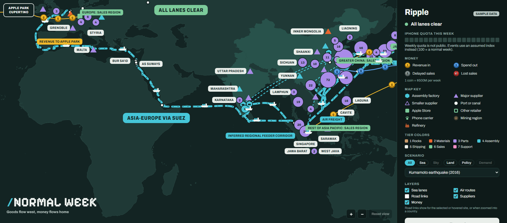
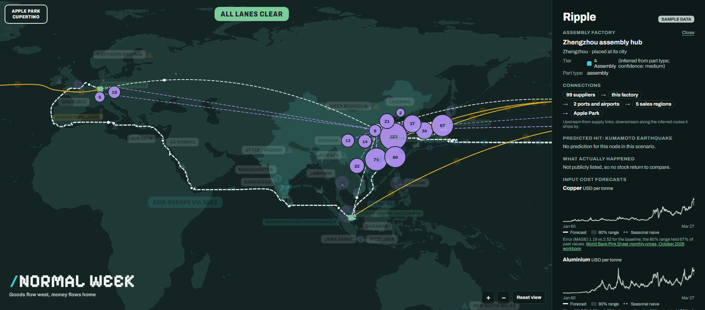

# Ripple

**An interactive map of Apple's publicly known supply chain, and of what happens to it when something breaks.**

Ripple takes the suppliers Apple discloses each year, places them on a world map, connects them to factories, ports, sea lanes, and sales regions, and replays real disruptions: the Suez Canal blockage, the Shanghai lockdown, the Kumamoto earthquake, and six more. For each event it shows which suppliers a model expected to be hit, then shows what actually happened to them.

It is built only from public data. It is a resilience case study, not a description of Apple's internal operations, and it does not recommend what Apple should do.

**Demo video:** [watch the walkthrough](VIDEO_LINK_TODO)



## What you can do

- **Explore the network.** Pan and zoom across every continent. At world zoom, the 704 disclosed supplier sites gather into clusters colored by their production tier. Zoom into a country and the clusters split into individual sites.
- **Trace a factory.** Click the Zhengzhou assembly hub to see its suppliers upstream and its path downstream: the ports and airports it ships through, the sea and air routes, the sales regions, and the money back to Apple Park. The panel summarizes it as a chain ("99 suppliers → this factory → 2 ports and airports → 5 sales regions → Apple Park"), and each step is clickable.
- **Drop a disruption.** Pick a past event and watch it ripple out. Closed routes turn red, then the wave reaches suppliers hop by hop, and each supplier fills with its predicted risk.
- **Replay predicted against actual.** Step through the event day by day. The panel ranks suppliers by predicted risk, marks the ones that were actually hit, and shows how the model scored on that event.



## How to run it

You need Node.js 20 or later.

```bash
cd web
npm ci
npm run build   # also runs the default-view checks
npm start       # http://localhost:3000
```

The interface reads `web/public/data/real/` when it exists and falls back to the sample data in `web/public/data/fixtures/`. To rebuild the real data, see `pipeline/README.md`. The pipeline is Python and runs from the project's `.venv`.

## Data sources

Every node and edge carries its own source title and link. The main sources:

| What | Source |
|---|---|
| Suppliers and their sites, by year | Apple Supplier Lists, matched to each event's own year (2011 uses the company-only January 2012 roster) |
| Site coordinates | Natural Earth 5.1.2 (province centroids and city points); no site is placed at an exact factory |
| Company facts, part types, Apple revenue share | SEC EDGAR filings and company facts, and company annual reports |
| Stock prices for the outcome labels | Yahoo Finance listings, plus exchange index reports |
| Ports, airports, straits, sea lanes | World Port Index, Natural Earth, and public corridor geography |
| Event dates and locations | USGS, WHO, Reuters, and Apple newsroom posts, cited per event |
| Input cost history | World Bank Pink Sheet (copper, aluminium, tin); SCFI Shanghai–Europe container freight |

## Methods

- **Outcome.** A supplier counts as "hit" when its stock had a significantly negative cumulative abnormal return (market model, trading days 0 to +10, t < −1.96). This measures how the market reacted to the company. It does not measure factory damage.
- **Model selection.** Three candidates compete: a distance-only rule (the closer a supplier's disclosed sites are to the shock, the riskier), a logistic regression, and LightGBM. Selection is nested leave-one-event-out: for each event, the candidates are compared using only the other six events, the winner is refit on those six, and only then is it scored on the held-out event. The selection protocol was committed before the run. Intervals come from bootstrapping over events, and SHAP values explain each prediction.
- **Routes.** A dated reference backbone: assembly hubs, gateways, sea lanes through the real straits, air corridors, and Apple's five sales regions. All routes are marked as inferred, and each supplier connects to its nearest gateway. The routes are illustrative and do not enter the model.
- **Tiers.** A supplier's production tier is mapped from its part type and marked as inferred, with a qualitative confidence. Where the part type is unknown, the tier stays unknown and the site is drawn grey.
- **Recovery plan.** An illustrative linear program (OR-Tools) on an indexed weekly quota, run with Monte Carlo draws over assumed ranges. Its units are an index, not devices.
- **Cost forecasts.** Chronos-Bolt (a pretrained time-series model), compared with a seasonal-naive baseline over rolling origins.

## Results, honestly

**Headline: nested leave-one-event-out AUC 0.64 (95% interval 0.54 to 0.75), with distance from the shock selected in all 7 folds.** The score covers seven scored events (843 supplier-event rows), and the interval comes from 2,000 bootstrap draws over events. An AUC of 0.5 is no better than chance.

Three candidates (distance only, logistic regression, and LightGBM) competed inside each training fold, and distance won every time. The network and company features built from public data did not add predictive value beyond distance for stock-market reactions across these events. The cause is not established. LightGBM fit its training events much better than the events it was held out from, which the report reads as limited generalization, but with 3 to 14 hits per event and coarse inputs it cannot say whether overfitting to few hits, differences between events, or weak features are to blame.

Each candidate's score on the held-out events, pooled:

| Candidate | AUC (point) | 95% interval | Folds won |
|---|---:|---|---:|
| Distance only | 0.64 | 0.54 to 0.75 | 7 of 7 |
| Logistic regression | 0.53 | 0.45 to 0.63 | 0 of 7 |
| LightGBM | 0.39 | 0.32 to 0.53 | 0 of 7 |

By event (each candidate refit without the event, then scored on it):

| Event | Companies | Hits | Distance | Logistic | LightGBM |
|---|---:|---:|---:|---:|---:|
| Kumamoto earthquake, 2016 | 100 | 4 | 0.66 | 0.67 | 0.47 |
| COVID containment in China, 2020 | 124 | 8 | 0.44 | 0.53 | 0.55 |
| Suez Canal blocked, 2021 | 126 | 3 | 0.88 | 0.87 | 0.63 |
| Russia technology export restrictions, 2022 | 123 | 7 | 0.53 | 0.48 | 0.36 |
| Shanghai lockdown, 2022 | 123 | 14 | 0.70 | 0.51 | 0.49 |
| Zhengzhou assembly restrictions, 2022 | 127 | 6 | 0.55 | 0.40 | 0.55 |
| Red Sea shipping attacks, 2023 | 120 | 3 | 0.63 | 0.36 | 0.56 |

With so few hits, each per-event AUC is very uncertain; distance scored below 0.5 on COVID. The 2011 Tohoku and Thailand events are left out of the scores because no supplier in them was hit, so an AUC cannot be computed. The map's risk colors now come from the distance model, refit for each event without that event. The full evaluation, including the selection table, the per-event intervals, and a check that the distance rule does not leak held-out labels, is in [data/review/evaluation_report.md](data/review/evaluation_report.md).

The cost forecasts did better: Chronos-Bolt had a lower error than the seasonal-naive baseline on all four series (MASE 0.77 to 1.54, against 1.59 to 3.39).

## Limitations

- **Stock reactions stand in for disruption.** A share price falling is not a factory stopping, and many suppliers are large conglomerates whose Apple business is a small part.
- **Locations are approximate.** Most sites are placed at a province centre, and Apple's lists do not say what each site makes for Apple.
- **Links are inferred.** Who supplies which factory, and which route goods take, comes from part-type compatibility and geography, not from disclosed shipments. Each link says so and carries a confidence.
- **Few events, few hits.** Seven scored events and 3 to 14 hits each cannot support strong claims. Some years have no verified Supplier List (FY2019, FY2024), so events in those years are left out, not filled in from another year.
- **Survivorship.** The company universe is today's listings, so delisted suppliers are underrepresented.
- **Illustrative planning.** Quotas, recovery options, and costs are assumptions shown as ranges. Apple's real production numbers are not public.
- **Unknowns stay unknown.** Revenue at risk and production losses are not public, and the interface says so instead of inventing them.

## How it was built

Two coding agents built it in parallel under an autopilot. Codex wrote the Python data and ML pipeline, Claude Code wrote the TypeScript interface (Next.js, React, d3-geo), and a human owned the shared data contract (`docs/contracts.md`). The agent setup is described in [docs/agent-setup.md](docs/agent-setup.md).
